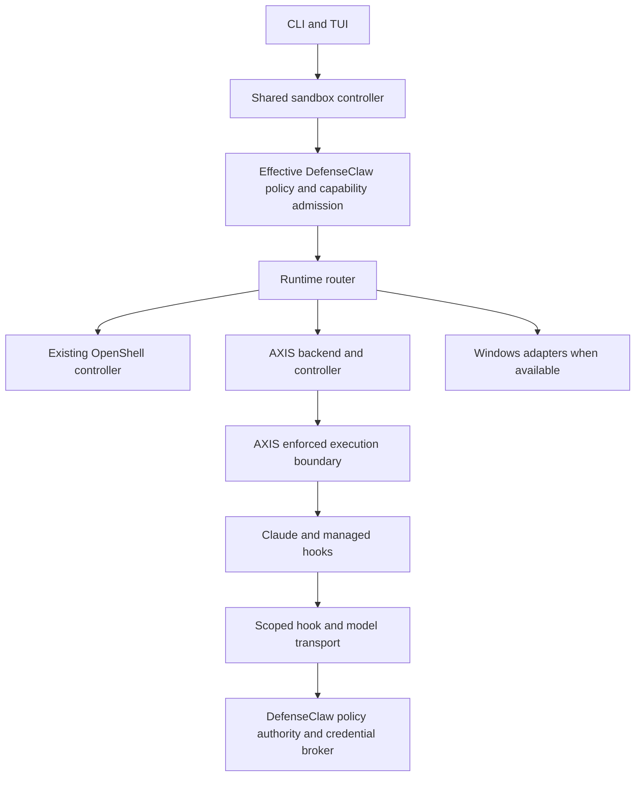

# AXIS sandbox integration plan

Add AXIS as a selectable DefenseClaw sandbox runtime alongside NVIDIA OpenShell.
DefenseClaw owns the command, policy, agent hooks, approvals, workspace review,
credentials, and telemetry; runtime adapters supply the execution boundary.
After selecting AXIS as the default, the customer continues to use
`defenseclaw sandbox run claude`.

Status: draft design for Claude review, October 17, 2026. This PR contains the
plan only. Implementation starts after Claude concludes that the plan is good
and blocking review findings are resolved.

## Baseline and prerequisite

The repository baseline is `main` at
`a6ab014b0ceb4c783e4afafce39fe6e1a76f249b`. AXIS findings below refer to upstream
commit `fb5fd5f0f9377c2ccb30d7e027a36373de0d037c` (Cargo version 0.3.5).
Use these references for review; select and revalidate the shipping AXIS pin
during implementation.

At this baseline, DefenseClaw exposes the sandbox REST API through
[`SandboxController`](../../internal/gateway/api_sandbox.go), constructs the
OpenShell manager in
[`buildSandboxRuntime`](../../internal/gateway/sidecar_sandbox.go), and stores
OpenShell configuration in
[`internal/config/config.go`](../../internal/config/config.go).
Runtime-neutral `sandbox.*` configuration and `--runtime` selection are proposed
behavior in this document, not features present on this baseline.

The development workspace also contains concurrent, unmerged Windows work:
`internal/sandboxruntime/`, common sandbox configuration, a runtime router,
capability admission, and Windows adapters. Before implementation, reconcile
that work with current `main`. Extend its shared abstraction if it lands first;
otherwise land the minimal shared abstraction as a reviewed prerequisite.
Do not introduce a competing runtime framework or fold unrelated Windows changes
into the AXIS work.

Current `main` already supports standalone managed computers through
[`per-user sandbox daemons`](../../internal/gateway/sandbox_daemon_runtime.go),
[`sandbox registrations`](../../internal/sandboxreg/), and
[`policy relays`](../../internal/sandboxrelay/). Preserve that architecture:
the managed gateway remains policy authority, while sandbox execution stays
under the user's account.

## Customer contract

The target commands are design examples. The runtime flag is an implementation
deliverable, not an instruction to run against the baseline release.

```text
defenseclaw sandbox setup --runtime axis
defenseclaw sandbox doctor --runtime axis

# Once the default runtime is configured:
defenseclaw sandbox run claude

# Override the default for a new session:
defenseclaw sandbox run claude --runtime openshell
defenseclaw sandbox run claude --runtime axis
```

Use the common configuration shape from the sandbox abstraction work:

```yaml
sandbox:
  enabled: true
  runtime: axis
  runtimes:
    axis:
      enabled: true
    openshell:
      enabled: true
```

Enabling or installing a runtime does not change the default. Setup offers an
explicit default selection and saves it through the shared configuration writer.
On managed hosts, administrator policy decides which runtimes are enabled and
whether a user can choose between them.

Resolve new sessions in this order: explicit runtime flag, configured default,
then the established host-specific `auto` selection. Existing Linux and macOS
OpenShell installations keep their default and supported legacy configuration.
An unavailable or policy-incompatible selection produces a specific error;
it never switches runtimes or runs the agent uncontained.

Record the creating runtime on each session. Resume, connect, stop, delete,
logs, review, and pull use that recorded identity even after the default changes.
The initial selector should require an explicit new session when the requested
runtime differs from a resumable session; it must not silently migrate it.

## Architecture



The diagram represents logical ownership. In per-user mode the policy authority
is the user's gateway. On standalone managed computers, the per-user sandbox
daemon uses authenticated registration and relays to the managed gateway;
it does not gain an independent policy evaluator or a user-editable policy file.

Keep the current OpenShell manager behind the shared controller initially.
Rewriting its internals into the new backend interface is not a prerequisite.
Keep the public `/api/v1/sandbox/` API and preserve all current operations,
including destinations, discovery, process inspection, and policy testing.
An AXIS operation without a verified implementation reports unsupported while
the same OpenShell operation continues to work.

The proposed backend contract covers discovery, policy admission,
provision/inspect/start/stop/delete, and execution. Terminal transport,
persistent sessions, workspace transfer, policy updates, image building,
credential binding, and MCP support are explicit capabilities.
Capabilities describe tested behavior of a pinned runtime and harness;
an upstream feature name alone is not evidence.

Keep runtime, actual backend/driver, execution OS, and enforcement posture
separate. AXIS process containment must not be described as the same boundary
as an OpenShell container or MicroVM. Record both the AXIS version and selected
underlying backend. A native macOS AXIS launch requires a Darwin harness
contract rather than relabeling it as a Linux workload.

Harness evidence needs a typed immutable identity: an OCI image for existing
container paths or a verified artifact bundle for AXIS process execution.
The bundle identifies the harness, launcher, hooks, managed configuration, and
their digests. Do not manufacture an image digest for a host executable.
Select workspace transport by backend capability rather than by execution OS.

## AXIS compatibility findings

These findings define the initial feasibility gates and the likely upstream
work. They do not establish production certification.

| Area | Behavior at the pinned AXIS commit | Integration consequence |
| --- | --- | --- |
| Launch lifecycle | `axis run` takes different paths depending on whether its daemon answers. The daemon branch waits for Ctrl+C; the standalone branch waits for the child and returns its exit code. | Choose a deterministic supervised execution path. Do not depend on an unrelated user daemon. |
| Terminal | Linux has a PTY bridge, but it opens fixed 24 by 80 geometry without an evident resize protocol. | Prove resize, raw input, signals, prompt interaction, and terminal restoration; contribute upstream support if needed. |
| Environment | The CLI collects a restricted environment, dropping arbitrary `DEFENSECLAW_*` keys and raw provider credentials. | Deliver derived hook configuration through protected files or a reviewed entrypoint/API. Do not rely on inherited variables. |
| Model authentication | Host injection is limited to supported local HTTP inference targets; external HTTPS CONNECT does not provide equivalent credential injection or HTTP path enforcement. | Validate a scoped host model relay, including Anthropic streaming. API-key and OAuth paths need separate acceptance. |
| Agent state | Recognized home directories can be copied, backed up, and temporarily redirected during preparation. | Give each session a private HOME and sanitized state; do not expose the customer's real Claude state or credential stores. |
| Network | Strict Linux proxy mode requires enforceable namespace/firewall support or the optional privileged helper. | Doctor must probe the requested policy and fail before launch when enforcement is unavailable. Proxy environment variables alone are insufficient. |
| Audit | Standalone execution bypasses daemon lifecycle handling; the proxy constructs an audit log without an evident export sink hookup. | DefenseClaw owns its lifecycle and policy events. Validate AXIS denial-event export before claiming complete runtime audit coverage. |
| Windows | Current native code rejects interactive ConPTY; README and setup descriptions also disagree about the supported launch slice. | Exclude native Windows from the initial interactive Claude offer. Qualify later against exact artifacts. |

Pinned upstream sources:

- [CLI launch paths](https://github.com/ROCm/axis/blob/fb5fd5f0f9377c2ccb30d7e027a36373de0d037c/crates/axis-cli/src/main.rs#L681-L892)
- [PTY bridge](https://github.com/ROCm/axis/blob/fb5fd5f0f9377c2ccb30d7e027a36373de0d037c/crates/axis-cli/src/pty_bridge.rs#L13-L95)
- [Environment collection](https://github.com/ROCm/axis/blob/fb5fd5f0f9377c2ccb30d7e027a36373de0d037c/crates/axis-core/src/sandbox_env.rs#L6-L99)
- [Provider inference targets](https://github.com/ROCm/axis/blob/fb5fd5f0f9377c2ccb30d7e027a36373de0d037c/docs/agent-provider-inference-targets.md#L29-L68)
- [Agent state lifecycle](https://github.com/ROCm/axis/blob/fb5fd5f0f9377c2ccb30d7e027a36373de0d037c/docs/agent-state-containment.md#L46-L66)
- [Linux enforcement prerequisites](https://github.com/ROCm/axis/blob/fb5fd5f0f9377c2ccb30d7e027a36373de0d037c/docs/linux-setup.md)
- [Proxy audit construction](https://github.com/ROCm/axis/blob/fb5fd5f0f9377c2ccb30d7e027a36373de0d037c/crates/axis-proxy/src/proxy.rs#L237-L285)
- [Windows terminal rejection](https://github.com/ROCm/axis/blob/fb5fd5f0f9377c2ccb30d7e027a36373de0d037c/crates/axis-sandbox/src/windows/mxc.rs#L454-L463)

## Policy and credential requirements

Resolve policy once: pack defaults, configuration, supported run overrides,
administrator constraints, then runtime capability admission. Render AXIS
enforcement configuration from that result. Keep AXIS OPA evaluation aligned
with DefenseClaw decisions; it must not become another editable source of policy.
Policy explanation shows runtime-specific clamps and refusals.

Require an enforced network boundary that permits only the scoped services
needed for the session. General web traffic must reach DefenseClaw destination
policy, approvals, blocklists, and SSRF checks. AXIS must not provide a parallel
direct egress path around those decisions. Verify model, hook, web, DNS, and
non-HTTP paths separately. Revocation must close affected ongoing access, not
merely change future connection decisions.

Keep provider credentials on the host. Reuse existing credential, policy, and
relay components where possible, extending their transport rather than adding
another login store. Authenticate and bind model access to the owned session;
validate request destinations and preserve TLS validation upstream. Prove the
declared credential scope, streaming behavior, expiry, rotation, and revocation
before admitting that authentication profile. A session-scoped relay is not
proof of OpenShell's executable-bound credential semantics.

Every upstream hop carrying a provider credential must use HTTPS with validated
TLS and an approved origin. Reject an HTTP target before attaching the
credential. Refuse redirects for credentialed model requests rather than
following them, including cross-origin redirects and HTTPS-to-HTTP downgrades.
Return a bounded, redacted refusal without contacting the redirect target.
Contract tests must prove that a credentialed request redirected to an unapproved
host is rejected with no target connection or credential disclosure, and that
an HTTP destination receives no credential. This rule concerns provider secrets;
the separately authenticated local hook/model channel must not carry those
secrets or expose a general-purpose host proxy.

Initial API-key qualification does not certify Claude subscription/OAuth, AWS
routes, arbitrary `--credential` substitution, or every child executable.
Reject an unsupported selected profile before creating the sandbox, and explain
the supported choices without copying host credentials into the workload.

Reuse Claude's connector and guardrail pipeline. Protect hook scripts and managed
settings at the actual containment boundary, use scoped and revocable hook
authentication, and run a hook-fire probe against the exact harness bundle.
Prove allow/block outcomes and resist hostile user/project settings. Keep the
hook path bounded; do not add runtime discovery or credential initialization to
each tool call. Strong permission-bypass operation requires independent proof
of containment, hook integrity, credential scope, and mandatory egress.

Use copied workspaces initially, with existing secret masks, bounded staging,
snapshot, review, pull, and undo behavior. Reject links and paths that escape the
owned workspace. Keep session HOME and caches separate between concurrent runs.
No stock AXIS agent policy may copy or rewrite the customer's real HOME.
Retain recoverable workspace state when cleanup fails.

## Deployment and installation

AXIS is optional. Disabled AXIS starts no process, listener, timer, watcher,
discovery scan, or helper. Keep its backend and dependencies out of hook binaries.
There is no new model requirement and GPU features are outside the initial scope.

Install only pinned, integrity-verified AXIS artifacts and the required backend
components into trusted installation-owned locations. Resolve executables from
those locations rather than project-controlled PATH entries. Do not download
or install dependencies silently. Any privileged helper, new listener, network
route, or artifact format needs explicit architecture review before code lands.

Document prerequisites by tier: AXIS and its selected executor are Required for
AXIS use; Linux runtime and strict-network prerequisites are Required when that
policy needs them; a privileged helper is Optional when another qualified
enforcement mechanism is available. Doctor reports the actual missing control,
not just whether `axis --version` runs. An AXIS-only installation must not require
the OpenShell gateway, OpenShell CLI, Docker, or OpenShell-specific host aliases.

On standalone managed computers, preserve the existing per-user daemon and
gateway authority split, authenticated peer identity, registrations, policy
generations, egress refresh, telemetry relay, and cross-user privacy. Local
runtime choices and environment variables cannot weaken administrator policy.
Qualify managed AXIS separately; keep it unavailable in deployment modes that
have not passed their own tests, including unsupported Secure Client routes.

## Implementation sequence

Each implementation PR includes every affected layer for its scoped behavior:
schema, Go/Python mirrors, migration when needed, documentation, packaging,
telemetry, and tests. No incomplete runtime is advertised as usable.

| Stage | Deliverable | Acceptance gate |
| --- | --- | --- |
| 1 | Reconcile current main with Windows abstraction work and preserve the complete current controller/API contract. | Review establishes one shared abstraction, managed-mode ownership, backwards compatibility, and prerequisite order. |
| 2 | Build a small Linux Claude feasibility prototype against pinned AXIS. | Deterministic lifecycle, real interactive and headless Claude, authenticated hooks, API-key streaming, private HOME, and strict egress pass. Any upstream blockers have a concrete resolution. |
| 3 | Add common runtime selection, capability reporting, configuration, and routing without enabling AXIS. | Existing OpenShell and managed-daemon tests pass; defaults, old records, and configuration round trips remain compatible. |
| 4 | Implement the AXIS backend, supervised I/O, session custody, artifacts, workspace handling, hooks, policy rendering, and scoped model transport. | Backend conformance, negative enforcement, failure cleanup, and crash recovery pass. Only proven capabilities are admitted. |
| 5 | Expose AXIS setup/default selection, doctor, TUI, wrappers, teardown, package detection, and telemetry. | AXIS-only and mixed-runtime workflows work through DefenseClaw. Both CLIs preserve arguments and exit codes; the UI uses reported capabilities. |
| 6 | Qualify the Linux preview and the separately offered deployment/authentication combinations. | Live acceptance evidence identifies host, artifact digests, harness version, policy, commands, and results. Support claims match that exact scope. |

Stages 1 and 2 precede production adapter design. Stop the AXIS milestone if a
required boundary or interactive transport cannot be established; do not convert
the request into an uncontained host launch or a weaker proxy-only mode.

## Implementation touchpoints

Existing paths below are on the baseline. Proposed package names are subject to
reconciliation with the Windows work.

| Concern | Existing source or proposed change |
| --- | --- |
| Common runtime controller | Extend the reviewed Windows `internal/sandboxruntime/` abstraction, or introduce its minimal reconciled prerequisite. Preserve all methods in `internal/gateway/api_sandbox.go`. |
| AXIS adapter | Proposed `internal/axis/`: discovery, verified artifacts, policy rendering, process/session ownership, terminal and workspace adapters. |
| Configuration | `internal/config/`, `schemas/config/v8/defenseclaw-config.schema.json`, `cli/defenseclaw/config.py`, shared writers and managed settings/relay contracts. Determine hot versus restart-required keys and maintain migration/default parity. |
| Gateway construction | `internal/gateway/sidecar_sandbox.go`, `sandbox_daemon_runtime.go`, `internal/sandboxreg/`, `internal/sandboxrelay/`; construct the selected adapters under the correct user's runtime. |
| CLI | `internal/cli/sandbox.go`, `internal/openshell/sandboxcli/`, `cli/defenseclaw/commands/cmd_sandbox.py`, command manifest; resolve runtime before OpenShell-specific preflight. |
| Agent assets and workspaces | Existing `internal/openshell/harness/`, `image/`, `workspace/`, `packs/`, gateway connector assets, and `internal/sandboxauth/`; extract only the necessary reusable contracts. |
| Operator surfaces | Python doctor/setup/uninstall, TUI launch/state/setup, shell wrappers, and macOS sandbox models where the shared API changes. Remove assumptions that every Unix runtime is OpenShell. |
| Telemetry | Typed runtime/driver identities, lifecycle, policy and refusal events in `internal/audit/` and the telemetry registry. Generate affected outputs and retain redaction and session correlation. |
| Documentation and release | Canonical operator setup/capability pages under `docs-site/content/docs`, CLI/config references, prerequisite tiers, packaging, rollback, and support matrix evidence. |

## Validation and release scope

Run unit and contract tests without an installed AXIS runtime, plus a separate
Linux live suite with real AXIS and Claude. Mocked success does not certify an
isolation boundary. Preserve the repository's normal pre-PR and affected-area
checks for each implementation PR.

| Test group | Required coverage |
| --- | --- |
| Selection and compatibility | Explicit/default/auto selection; disabled or unavailable runtime; legacy OpenShell configuration and records; mixed lists; default changes; resume mismatch; every existing OpenShell API operation. |
| Lifecycle and terminal | Interactive/headless exit status; streams; resize; Ctrl+C/Ctrl+D; terminal restoration; timeout; parent death; descendant cleanup; teardown; concurrency; restart reconciliation. Unsupported persistence/detach modes refuse clearly. |
| Hooks and policy | Real hook-fire allow/block probe; hostile settings; tamper/silence detection; authenticated ingress; effective admin clamps; no direct control-API access; unsupported resource policy refused before launch. |
| Credentials and egress | Raw secret absence in guest environment, files, logs, and telemetry; API-key and OAuth independently; Anthropic streaming; expiry/revocation; HTTPS required before credential attachment; credentialed redirects refused, including unapproved-host and downgrade targets, with no target connection or credential disclosure; direct network bypass blocked; DNS/non-HTTP paths; approvals and policy refresh. |
| Workspace and ownership | Private HOME; no real Claude state migration; secret masks; copied project review/pull/undo; archive/path safety; two simultaneous sessions; recovery preserving user changes; operations restricted to owned instances. |
| Deployment and UI | AXIS-only installation; both providers installed; disabled runtime has no background cost; missing prerequisites; config save/load and managed controls; correct TUI runtime arguments and action availability; uninstall cleans only owned artifacts. |
| Managed execution | Per-user daemon identity; gateway registration and policy authority; generation/revocation; relay failures; cross-user refusal/privacy; upgrade and rollback against supported prior configurations. |

Initial release scope is an opt-in Linux preview for Claude with copied
workspaces, real interactive/headless execution, and individually qualified
authentication profiles. Existing OpenShell behavior remains supported.
Native macOS, Windows/WSL2, other harnesses, live mounts, GPU/VM backends,
MCP import, executable-bound generic credentials, learn mode, and persistent
attach are later qualification work unless explicitly added to the accepted
initial scope. Unsupported features are visible refusals, not silently ignored
settings.

## Review decisions

Claude's review should resolve these design decisions before implementation:

1. Is the shared abstraction reconciled with current main and the Windows work,
   including managed daemon ownership and every current API operation?
2. Which deterministic AXIS launch/API path meets lifecycle and terminal needs,
   and which changes belong upstream rather than in a local workaround?
3. Can the hook and model transports preserve the required authentication,
   credential scope, streaming, revocation, and network boundary?
4. Is artifact-bundle verification sufficient for immutable Claude hooks and
   configuration without weakening existing image evidence?
5. Are initial platforms, deployment modes, authentication profiles, and
   unsupported capabilities explicit enough for accurate customer claims?

Record the review outcome and any amendments on this draft PR. A positive
review authorizes starting the implementation sequence; it does not certify
AXIS or authorize merging or releasing unverified runtime support.
