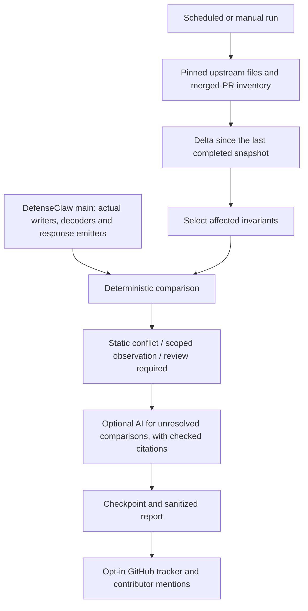

# Upstream Connector Delta Monitor

Codex or Claude Code can change how hooks are discovered, called or allowed to
block a tool. This monitor checks those upstream changes against the connector
code on DefenseClaw main. It does not install either client, change hook settings
or run downloaded source. **Codex and Claude Code only; Cursor is not included.**

## Flow



Eight shared invariants cover discovery, registration, events, payloads, blocking
responses, execution/timing, failure exits and lifecycle correlation. Each
provider supplies the concrete upstream artifacts and current local bindings.
AI is off by default and cannot independently declare a breaking change.

Examples:

- An explicit retirement of our registration path is a static conflict. A new
  default path alone needs review: the old path might still be supported.
- A payload string becoming an integer conflicts with our string decoder.
  Adding an optional field is only a scoped observation when existing constraints
  are unchanged.
- Tightening a response schema is not a break if it still accepts our emitted
  deny response. Changes to runtime handling may still need separate review.

**Zero watched changes is not proof of safety.** The bounded PR-file inventory
also flags hook-related changes outside the watchlist. Missing evidence and
unsupported syntax remain coverage gaps or review items, never a safe verdict.
The first snapshot is a baseline, not a compatibility check of all existing code.

## OS and deployment scope

Bindings are separated by `connector → OS → user / managed`. Windows Codex also
records its older managed-user layer separately from machine requirements.

| Scope | Claude Code | Codex |
| --- | --- | --- |
| User, all OSes | Home-relative `.claude/settings.json`; `CLAUDE_CONFIG_DIR` | Home-relative `.codex/config.toml`; `CODEX_HOME` |
| Managed Linux | `/etc/claude-code/managed-settings.d/90-defenseclaw.json` | `/etc/codex/requirements.toml` |
| Managed macOS | `/Library/Application Support/ClaudeCode/managed-settings.d/90-defenseclaw.json` | `/etc/codex/requirements.toml` |
| Managed Windows | `%ProgramFiles%\ClaudeCode\managed-settings.d\90-defenseclaw.json` | `%ProgramData%\OpenAI\Codex\requirements.toml` |
| Launching | POSIX shell on Unix; guarded cmd/native exec on Windows | POSIX shell on Unix; PowerShell on Windows |

These values are checked against local source, not the runner's filesystem.
WSL uses Linux bindings. A bare OS keyword does not select a deployment: an
ambiguous OS-specific change stays review-required. Higher-precedence MDM,
registry/server policy and arbitrary quoting/control flow are not certified.
Static bindings and native Python CI are **not** live-client OS verification.

## Notifications and rollout

GitHub tracker issues/comments mention `ihabler`, `habler-code`, `vineethsai`,
`vineethsai7` and `sanjayab23`. Informational changes are included, with what to
inspect even when no break is established. GitHub email depends on recipients'
settings/access; this is not SMTP or a private mailbox channel. Sensitive conflict
details and raw AI output are excluded from public posts/artifacts.

1. PR checks run offline tests on Linux/macOS/Windows and a read-only upstream
   smoke test against current DefenseClaw main. AI and publication are off.
2. After merge, run `Connector Delta Monitor` manually on main with `notify=false`.
   This exercises checkpoint restore and persistence without sending notices.
3. Test delivery explicitly before enabling scheduled publication. A successful
   API post does not prove that each recipient received an email.
4. Scheduling requires `CONNECTOR_DELTA_MONITOR_ENABLED=true`; publication also
   requires `CONNECTOR_DELTA_NOTIFICATIONS_ENABLED=true`. Both default off.
   Manual publication additionally requires the `notify` input. No repository
   switches are enabled by this PR.

Analysis has read-only permissions. The separate, opt-in publisher has
`issues:write` and runs only from main. Checkpoints preserve unfinished batches;
an outbox and receipts retry notices without repeatedly posting the same signal.

## Files and tests

```text
scripts/connector_delta_monitor.py       CLI
scripts/connector_delta/
  connectors/{codex,claudecode}/         manifests, bindings, extractors, OS profiles, fixtures
  shared/                               invariant catalog, AI prompt, recipients
  monitor.py, invariants.py              orchestration and comparison
  provider.py, platform_bindings.py      trusted local evidence readers
  inventory.py, history.py, platforms.py PR inventory, replay and scope
  notifications.py                      sanitized reports and publisher
  docs/                                 implementation reference and backtest records
cli/tests/connector_delta/               offline regressions
.github/workflows/connector-delta-*.yml   checks and opt-in production monitor
```

```sh
python3 -m unittest discover -s cli/tests/connector_delta -v
python3 scripts/connector_delta_monitor.py backtest-invariants --connector codex --output /tmp/codex-mutations.json
python3 scripts/connector_delta_monitor.py backtest-invariants --connector claudecode --output /tmp/claude-mutations.json
```

[Implementation and CLI reference](docs/implementation.md) ·
[Backtest evidence and limitations](docs/backtests.md)
