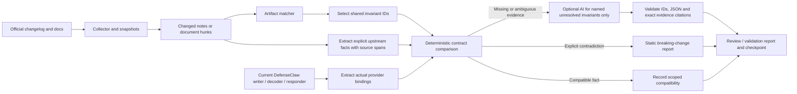

# Connector Delta Monitor: shared invariants, Claude Code and Codex

This maintainer tool asks whether a public upstream Claude Code or Codex change could
affect the current DefenseClaw integration. It runs independently of the agent
and gateway. No client installation, setup, upgrade or connector configuration
change is part of collection, analysis or replay.

Only **Claude Code and Codex** have implemented providers in this version.
Nothing installs or runs either agent. Other connectors, including Cursor,
are not monitored by this implementation.

## Layout

```text
scripts/connector_delta_monitor.py       # Stable CLI entry point
scripts/connector_delta/
  monitor.py, invariants.py, provider.py  # Shared collection/comparison
  history.py, inventory.py, platforms.py
  notifications.py                     # Public projection + GitHub publisher
  shared/
    invariants.json, system-prompt.txt, notifications.json
  connectors/
    __init__.py                         # Explicit trusted provider registry
    claudecode/
      manifest.json, bindings.json, provider.py
      fixtures/invariants.json, fixtures/history-labels.json
    codex/
      manifest.json, bindings.json, provider.py
      fixtures/invariants.json
```

## Components

| File | Responsibility |
| --- | --- |
| `monitor.py` | Collection, snapshots, matching, bounded AI context, checkpoints and reports |
| `invariants.py` / `shared/invariants.json` | One vendor-neutral catalog and deterministic comparator; never calls AI |
| `connectors/<name>/manifest.json` | Upstream watchlist, PR inventory routing, local consumers and suggested tests |
| `connectors/<name>/bindings.json` / `provider.py` | Actual local-code bindings and narrowly recognized upstream facts |
| `provider.py` | Shared trusted source reading, version selection and evidence utilities |
| `history.py` | Bounded first-parent historical replay |
| `inventory.py` | Merged-PR file inventory; unwatched hook-related files remain review targets |
| `platforms.py` | Conservative OS scope and explicit platform coverage limits |
| `shared/system-prompt.txt` | Invariant-scoped AI instructions and strict finding shape |
| `connectors/<name>/fixtures/` | Mutation regressions and available historical labels |
| `notifications.py` / `shared/notifications.json` | Public-safe projection and deduplicated maintainer mentions |
| `.github/workflows/connector-delta-monitor.yml` | Read-only analysis and separate opt-in issue publisher |



The manifest covers hook events, response semantics, runtime behavior, policy
and configuration discovery, input/correlation fields, telemetry and plugin
inventory. An unmapped hook change goes to review. It maps both native hook
execution and the existing shell adapter; modern integrations must not be
analyzed solely against a legacy shell script.

## Shared invariant contract

The direction is **upstream host change -> existing DefenseClaw behavior**.
These are behavioral requirements, not checks that DefenseClaw preserves old
schemas. The shared engine has no Claude event names, paths or response keys.
Each provider supplies its actual values and code evidence.

| Invariant | Claude binding on current main | What constitutes a conflict |
| --- | --- | --- |
| `hook.discovery` | Default local user registration: `~/.claude/settings.json`; `CLAUDE_CONFIG_DIR` override recorded | Host explicitly stops reading that path, or declares an exclusive replacement set without it |
| `hook.registration` | Top-level `hooks`, handler `type: command`, extracted from the config writer | Host explicitly retires an emitted key or handler type |
| `hook.event_delivery` | Version-selected contract events cross-checked with actual registration declarations | An owned event is explicitly removed; adding an event is not a removal |
| `hook.payload` | JSON field types extracted from `claudeCodeHookRequest` | A declared incoming type cannot be decoded; optional-field removal remains review |
| `hook.decision` | Actual event-specific block JSON from `claudeCodeOutputForProfile` | Host explicitly ignores the exact emitted deny encoding, not some other encoding |
| `hook.execution` | Synchronous enforcement events; PreToolUse pre-action phase; explicit timeout helper values | Host removes the wait barrier, moves the action phase, or caps the configured budget |
| `hook.failure` | Native strict-unreachable result uses `blockExit`, resolved to `2` | Host stops honoring that blocking exit status on the bound event |
| `hook.correlation` | Paired tool lifecycle and `tool_use_id` | Host removes or incompatibly changes the required pairing identity |

Applicability is explicit: these eight definitions currently apply to the
`command-hook` transport. A proxy-only connector is `not_applicable`, not an
invented hook path. A future provider can bind the same invariants to different
artifacts. Claude Code and Codex now have real monitor providers; a test-only
third binding also checks reuse. Cursor remains future work.

## Codex artifacts and comparisons

Codex uses the same eight invariant IDs, comparator, evidence checks and optional
AI adapter. Its provider reads **24 fixed upstream artifacts**, all from a single
immutable `openai/codex` revision per snapshot. It never imports or runs them.
`connectors/codex/manifest.json` is the exact source inventory; its `bindings.json` maps each source
ID to the specific invariants it can affect, avoiding broad AI questions.

| Invariant | Upstream Codex artifact(s) | DefenseClaw dependency |
| --- | --- | --- |
| Discovery | `utils/home-dir/src/lib.rs`, `config/src/lib.rs`, `hooks/src/engine/discovery.rs` | `codexHomeDir` / `codexConfigPath`: default `~/.codex/config.toml`, with `CODEX_HOME` override |
| Registration | `config/src/hook_config.rs`, discovery loader | `buildCodexHooksTable`, position-aware `codexHookStateKey` and canonical `codexCommandHookHash`; top-level hooks and command handlers |
| Events | Typed `HookEventsToml`, its event-to-group dispatch, `core/src/hook_runtime.rs`, `core/src/tools/registry.rs` | Current version-selected registered events, cross-checked with active declarations |
| Payload | Generated PreToolUse, PostToolUse and PermissionRequest input schemas; `hooks/src/schema.rs` | JSON-tagged types in `codexHookRequest` |
| Decisions | Nine generated event-specific output schemas, `engine/output_parser.rs`, wire types | Actual emitted PreToolUse deny, PermissionRequest nested deny, `continue: false`, or top-level block, depending on event |
| Timing/budgets | Dispatcher, command runner, pre-tool runtime, SessionEnd constants, actual tool dispatch sites | Synchronous command registrations; explicit 30/90-second budgets and 3-second SessionEnd budget |
| Failures | PreToolUse exit-code handling and command execution | Native strict-unreachable result uses blocking exit 2 |
| Correlation | PreToolUse/PostToolUse input schemas and hook/tool dispatch | Paired `tool_use_id`; PermissionRequest is not a paired-ID surface |

Upstream paths in that table are relative to `codex-rs/`. Nine output schemas
cover PreToolUse, PermissionRequest, SessionStart, UserPromptSubmit, PostToolUse,
SubagentStop, PreCompact, PostCompact and Stop. SessionEnd is advisory: the local
responder does not emit a deny for it, and its timeout change is routed only to
`hook.execution`, not a fictitious SessionEnd blocking invariant.

The discovery scope is **local user inline hooks**, not certification of every
managed/Windows/cloud/plugin configuration. Changing only a default directory
creates a concrete review item until legacy-path support is established; it is
not automatically an explicit old-path retirement. Trust changes are compared
with the inline command identity functions, not assumed to be plugin changes.

JSON-schema comparison supports bounded local `definitions`/`$defs` references
and single-reference `allOf`, closed-property removals, field types and emitted
deny enum values. Remote references, cycles and unsupported schema constructs
stay unknown. An unconstrained `tool_input: true` schema is not proof that all
actual tool invocations became strings. Generated schemas prove wire constraints,
not that the runtime still applies a decision: parser/dispatch changes remain
named review items unless a recognized deterministic fact can be extracted.

Rust extraction recognizes a few source contracts, not arbitrary program
semantics. Event removal requires both the typed event declaration and matching
exhaustive group dispatch; omission from a documentation list remains insufficient.
Comments, raw strings and test-only declarations cannot manufacture those facts.
Active local timeout declarations are read separately from legacy migration examples.

### Codex collection and historical replay

```bash
python3 scripts/connector_delta_monitor.py collect --connector codex \
  --include-pr-inventory --state output/connector-delta-monitor/codex-state.json \
  --output output/connector-delta-monitor/codex-snapshot.json

python3 scripts/connector_delta_monitor.py analyze --connector codex \
  --snapshot output/connector-delta-monitor/codex-snapshot.json \
  --state output/connector-delta-monitor/codex-state.json \
  --output output/connector-delta-monitor/codex-report.json \
  --summary output/connector-delta-monitor/codex-report.md

python3 scripts/connector_delta_monitor.py collect-history --connector codex \
  --history-count 15 --output output/connector-delta-monitor/codex-history.json

python3 scripts/connector_delta_monitor.py backtest --connector codex \
  --history output/connector-delta-monitor/codex-history.json \
  --output output/connector-delta-monitor/codex-historical.json \
  --summary output/connector-delta-monitor/codex-historical.md

python3 scripts/connector_delta_monitor.py backtest-invariants --connector codex \
  --output output/connector-delta-monitor/codex-invariant-backtest.json
```

The first Codex analysis seeds source baselines; it does not assert current
compatibility. Later runs compare newly pinned main snapshots, even without
release notes. `--connector claudecode` is the default and retains its changelog
and official-documents workflow. Use separate state/output files per provider.

`collect-history` performs network reads only: it samples 1..30 recent commits
from main-filtered hook/config history, then pins each commit and its first
parent. Each transition is replayed independently against the current checkout;
it does not invent a linear chain across merged branches. This is a bounded
sample, not an exhaustive merged-PR feed. It can miss core-only commits outside
those sampling paths even though ongoing main-snapshot monitoring watches the
listed core artifacts. Missing/renamed parent files remain coverage gaps, not
clean results. Historical replay is offline and deterministic; optional AI is
tested separately with fixtures and available for normal incremental analysis.

Every result carries scope, local values, source revision, exact quote, character
span and line number for both sides. Local bindings come from repository code,
not from the LLM. Unknown Go shapes or stale registry/writer mismatches produce
`review_required`; they never silently reuse a hardcoded compatible value.

Upstream facts currently come from bounded, recognized explicit statements and
specific Markdown contract tables. This is deliberately a narrow extractor,
not a general natural-language proof system. Inventories can demonstrate that a
path/event is still listed; an omission cannot demonstrate retirement. JSON
examples have `example` authority and cannot prove a breaking type change.
Scoped cloud/plugin/project statements, hypothetical clauses and vendor fixes
are not promoted into local default-path retirement claims.

`breaking_change` means a **static documented contract conflict** with the
current binding, always `runtime_verified=false`. It does not certify that a
released binary regressed. Findings with unresolved companion invariants stay
review candidates even if one narrower comparison is compatible. Telemetry,
plugin inventory and unclassified hook changes remain visible as unbound review
items; this version does not send a broad LLM question for them.

## Requirements and outbound access

| Requirement | Tier | Details |
| --- | --- | --- |
| Python 3.10+ | Required for this maintainer tool | Standard library only; tested locally on 3.12 and 3.14, workflow selects 3.13 |
| Git and a local DefenseClaw checkout | Required | Reads the current revision and the manifest's repository files |
| Public source access | Optional | Collection reads `api.github.com`, `raw.githubusercontent.com` and `code.claude.com` over HTTPS/443 |
| Anthropic Messages API and a model ID | Optional | Only `--ai anthropic` accesses `api.anthropic.com`; requires `ANTHROPIC_API_KEY` and `--model`, with an explicit per-run call budget |
| GitHub Actions and GitHub CLI | Optional | The hosted workflow uses `gh` to recover its own state artifacts; neither is required for offline replay |
| GitHub issue publishing | Optional | The separately enabled publisher uses only `api.github.com` over HTTPS/443 with scoped issue-write permission; never on the agent path |

This is repository tooling, not an installed DefenseClaw feature. It introduces
no runtime config key, doctor requirement, service, listener, packaging payload
or work on the hook/gateway path. Existing OSS and managed installations do not
invoke it. Use `--ai off` for network-free analysis, and do not run `collect` for
a fully offline replay.

URLs are fixed and allowlisted, redirects are refused, certificates use the
platform's verified HTTPS trust, inputs and context are bounded, and source
fingerprints use SHA-256. GitHub credentials are sent only to GitHub's API;
model credentials are sent only to Anthropic's API. Source text and code snippets
are treated as untrusted data, not executable tools. Credentials and local user
configuration are never included in review packets.

## Local use

Run from the checkout being analyzed. Commands write only the specified evidence,
state and report files. `output/connector-delta-monitor/` is ignored by Git.

```bash
python3 scripts/connector_delta_monitor.py collect \
  --include-pr-inventory --state output/connector-delta-monitor/state.json \
  --output output/connector-delta-monitor/snapshot.json

python3 scripts/connector_delta_monitor.py analyze \
  --snapshot output/connector-delta-monitor/snapshot.json \
  --state output/connector-delta-monitor/state.json \
  --output output/connector-delta-monitor/report.json \
  --summary output/connector-delta-monitor/report.md \
  --emit-prompts output/connector-delta-monitor/prompts
```

The first Claude Code analysis reviews the latest 20 available releases and establishes
document baselines. `--lookback` changes that initial window. Later runs compare
the entire saved source with the new snapshot, including edited and removed
notes. Document changes are compared as hunks; unchanged surrounding text does
not create a relevance match. A first document fetch is `baseline_created`, not
evidence that the integration is compatible.

For semantic analysis, supply a model ID appropriate to your approved account:

```bash
python3 scripts/connector_delta_monitor.py analyze \
  --snapshot output/connector-delta-monitor/snapshot.json \
  --state output/connector-delta-monitor/ai-state.json \
  --output output/connector-delta-monitor/ai-report.json \
  --summary output/connector-delta-monitor/ai-report.md \
  --ai anthropic --model YOUR_APPROVED_MODEL_ID --max-ai-calls 10
```

The process reads the API key from the environment. Do not put it in arguments,
fixtures or checked-in files. Missing credentials, invalid/truncated model output,
invented paths/quotes/line numbers/test commands and exhausted budgets are
reported as gaps. No failure becomes `no_impact`. Exact citations establish
grounding, not the correctness of a model's inference; maintainers still review it.

Each model request contains one changed note/hunk, only named unresolved
invariants, their actual local values, numbered code excerpts and permitted test
suggestions. Each invariant needs its own grounded comparison, with the local
citation inside that binding's evidence ranges. Unverified local extraction
stays visible for human review without a model call. The model cannot
execute suggestions, override deterministic conflicts, or return a confirmed
`breaking_change`; a suspected break must be `validation_required`. The adapter
requires plain JSON text and rejects tool blocks and incomplete responses.

Example generated question:

> For hook.discovery in scope user-default, does this delta contradict the
> supplied local binding? Identify the exact changed value and consumed value;
> otherwise state the missing evidence.

The binding supplied with that question contains the actual `paths` value and
the relevant writer functions. A decision question instead includes concrete
event-to-response mappings, e.g. PreToolUse's
`hookSpecificOutput.permissionDecision=deny`. The system prompt is versioned in
`shared/system-prompt.txt`; `--emit-prompts` saves the exact packets for inspection.

## PR inventory: zero watched changes is not safety

Scheduled collection includes `--include-pr-inventory`. It lists recently
updated closed PRs targeting main, filters merged PRs, and checks the full
paginated changed-file inventory, including previous names on renames.
Provider-owned path rules identify hook-related changes outside the fixed
watchlist. These become `review_required`, with the affected invariant IDs,
local bindings and concrete review instructions; they are never declared safe
or breaking just because a path matched. No broad AI question is sent.

For example, Codex's hook additional-context renderer can change while all 24
watched files are identical. That creates an informative notice to inspect
context delivery and response handling. A new Claude managed-settings example
likewise prompts review of user-hook discovery **if adopted**, not a claim that
upstream defaults changed.

Inventory is bounded: up to 300 updated closed PRs, ten merged PRs per batch,
and 1000 files per PR. The first run considers the latest ten only. Subsequent
runs drain newer PRs oldest-first; incomplete file lists, an unreachable prior
window or deferred backlog are explicit coverage gaps. This is not an
exhaustive historical merged-PR certification.

## Linux, macOS and Windows scope

Keep the eight shared requirements; vary bindings by OS and deployment scope
rather than duplicating the catalog. The common JSON wire contract is useful
on all three OSes, but identical path spelling does not prove discovery or
execution parity. Reports mark all three as **partial static coverage**, not
live-client certification.

| Surface | OS-specific concern |
| --- | --- |
| Discovery / registration | User-home resolution, env overrides, administrator layers and policy precedence |
| Execution / failure | POSIX shell versus native Windows executable/argv, spaces/quoting, missing-launch behavior |
| Payload / decision / correlation | Common wire types and IDs, with any explicit upstream OS qualification preserved |

Current code already demonstrates why this matters: Claude uses a native
Windows launcher but a guarded POSIX command on Unix; Codex's managed Windows
hook layer uses `managed_config.toml` while per-user registrations use
`config.toml`. This monitor does not fully extract those managed/launching
contracts. OS-qualified discovery, registration and execution changes therefore
stay review-required rather than becoming global proof. WSL is a Linux runtime,
not evidence of native Windows behavior. No host OS is guessed from the runner.

## Workflow operation

After this local change is reviewed and merged, set repository variable
`CONNECTOR_DELTA_MONITOR_ENABLED=true` to enable the six-hour schedule. A manual
dispatch on `main` is an explicit one-off run even while scheduling is disabled.
Disable the variable or the workflow to stop all scheduled collection and cost.

The default is deterministic invariant analysis, with unresolved evidence kept
as review. To opt into model calls, also set:

- Repository variable `CONNECTOR_DELTA_AI_ENABLED=true`.
- Repository variable `CONNECTOR_DELTA_MODEL` to an approved model ID.
- Repository secret `CONNECTOR_DELTA_ANTHROPIC_API_KEY` to a dedicated API key.

Analysis has only `contents: read` and `actions: read`. Claude and Codex run in
isolated matrix jobs. Full reports and model output remain local to that
runner; public job summaries and report artifacts contain only a sanitized
projection and public upstream metadata. Source checkpoints are retained for
90 days; sanitized report/notification artifacts for 30 days. AI caches are
stripped before public checkpoint upload. No runtime configuration, contract,
branch or installed agent is changed.

### Informative GitHub/email notices

After review and merge, set `CONNECTOR_DELTA_NOTIFICATIONS_ENABLED=true` to opt
into the separate publisher job. It alone has `issues: write`. It maintains one
bot-owned tracker issue per connector and comments only for new signals. Each
notice mentions `ihabler`, `habler-code`, `vineethsai`, `vineethsai7` and
`sanjayab23`; GitHub email delivery depends on their notification settings and
repository access. This is the same mechanism as PR-review notification emails,
not SMTP, a new local service, or guaranteed mail delivery.

Informative notices are sent for relevant review changes even with zero
deterministic breaks: public upstream PR title/link, changed unwatched files,
what to inspect, and the explicit coverage warning. Proven conflicts are
redacted to a generic request for private investigation—no values, snippets or
bypass recipe. A public GitHub issue is **not** a private email channel. Follow
`SECURITY.md` and reproduce full evidence locally for sensitive investigation.
Raw snapshots, detailed reports and AI caches are never uploaded as report
artifacts or pasted into issues.

By default the destination is the current repository and the writer is
`github-actions[bot]`. An approved alternative repository can be configured with
`CONNECTOR_DELTA_ALERT_REPOSITORY`; cross-repository delivery needs the scoped
secret `CONNECTOR_DELTA_ALERT_TOKEN` and its account's exact
`CONNECTOR_DELTA_ALERT_AUTHOR`. Recipients need access if that destination is
private. All destinations receive the same redacted content. No arbitrary
email addresses or credentials are committed. With notifications off, no
publisher job, issue call or mention occurs. An empty incremental run does not
close an existing incident or declare it resolved.

A public-safe outbox is checkpointed separately from source progress. Failed
or disabled publishing keeps notices pending; a successful publisher writes a
receipt, and the next run removes only acknowledged IDs. Repeat issue/comment
markers deduplicate a retry after a network interruption. Batches contain at
most 200 notices, with a bounded 1000-item outbox; saturation fails visibly
instead of dropping older notices. Large messages drain across runs, acknowledging
only the portion actually published. This records GitHub acceptance, not mailbox
delivery, and does not promise exactly-once email.

Successful AI results are cached locally, not in public artifacts. A source checkpoint advances only after that
source's batch finishes; other sources may advance independently. Pending
batches are frozen so a smaller AI budget cannot silently drop changes as new
releases arrive. Newer source snapshots wait for the next run after the frozen
batch completes. Exit code 2 signals incomplete collection/analysis or failed
backtest expectations. Zero means the requested analysis completed, not that all
findings are benign.

A prompt, manifest, invariant catalog/bindings, extractor/comparator implementation,
backend or model change explicitly starts a new initial analysis window
(`baseline_reset=true`). Changing only connector runtime code affects the
AI cache's context digest but does not automatically replay old upstream notes.
Use `backtest` for an intentional re-evaluation against a changed integration.

If earlier workflow runs exist but their state cannot be recovered, the workflow
fails visibly instead of silently treating the present as a fresh baseline.
Restore a saved state artifact before resuming. State is operational evidence;
keep a copy if the monitor will be stopped beyond artifact retention.

## Historical replay

Replay uses the saved source and the **current checkout**. It makes no claim
about what DefenseClaw would have detected at the historical release date.

```bash
python3 scripts/connector_delta_monitor.py backtest \
  --snapshot output/connector-delta-monitor/snapshot.json \
  --from-version 2.1.150 --to-version 2.1.301 \
  --expectations scripts/connector_delta/connectors/claudecode/fixtures/history-labels.json \
  --output output/connector-delta-monitor/historical.json \
  --summary output/connector-delta-monitor/historical.md
```

The recorded experiment used changelog revision
`03b5892ee77de289bcd5dfa39f541525ade74aff`. Recover that immutable changelog with
`collect --upstream-revision 03b5892ee77de289bcd5dfa39f541525ade74aff`; documentation
fetched by that command is still current and is only baselined in this replay.
The local results and manual comparisons are in
[`docs/research/claude-delta-monitor-backtest.md`](../../docs/research/claude-delta-monitor-backtest.md).

## Validation and limits

```bash
python3 -m unittest discover -s cli/tests -p test_connector_delta_monitor.py -v
python3 -m unittest discover -s cli/tests -p test_connector_invariants.py -v
python3 -m unittest discover -s cli/tests -p test_connector_codex_delta.py -v

python3 scripts/connector_delta_monitor.py backtest-invariants \
  --output output/connector-delta-monitor/invariant-backtest.json \
  --summary output/connector-delta-monitor/invariant-backtest.md

ruff check scripts/connector_delta_monitor.py scripts/connector_delta/ \
  cli/tests/test_connector_delta_monitor.py cli/tests/test_connector_invariants.py \
  cli/tests/test_connector_codex_delta.py cli/tests/test_connector_delta_inventory.py \
  cli/tests/test_connector_delta_notifications.py
```

The 32 Claude and 23 Codex synthetic cases exercise explicit path retirement, retained legacy paths,
scope/negation guards, registration changes, event removal/addition, type changes,
optional fields, actual versus unconsumed decisions, async/phase/timeout changes,
blocking exit codes, and example/table omissions. These are mutation regressions,
not discoveries of actual upstream breakage.

The Claude Code source provider is public changelog/documentation, not a complete
feed of its runtime PRs. Historical documentation snapshots are not available
in this first experiment; document diffs are tested hermetically. The rules
prioritize recall and still select some UI-only and separate mod-hook changes.
`filtered` means no manifest match, not proof of safety. The curated labels are
development cases used during tuning, not an independent precision/recall score.
The live model API and hosted workflow require separate smoke runs after the
required credentials and reviewed workflow are available.

To expand to Cursor later, add a source collector plus a provider binding/extractor that
produces these same local bindings and evidence-backed upstream facts. Reuse
the catalog, comparison engine and invariant-scoped AI schema. Cursor can use official contract-document snapshots.
No agent installation is needed. New transport requirements should add an
explicit invariant/applicability rule, not a vendor exception in the engine.
